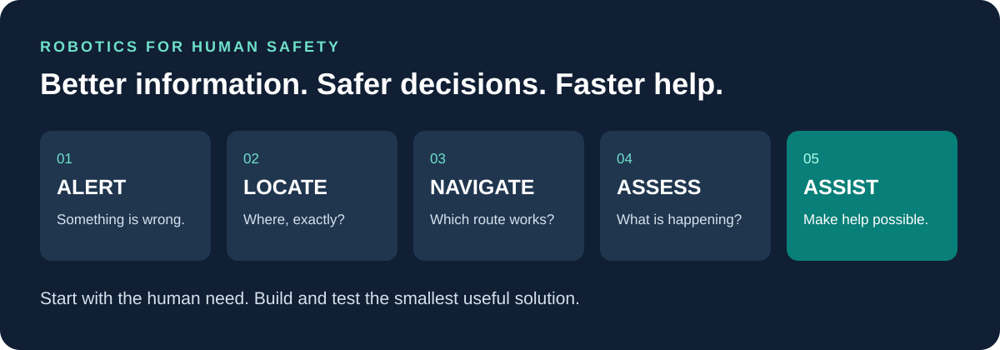

# Robotics for Human Safety
### Good questions. Real examples. People worth protecting.

**What could a robot do before we ask a person to step into danger?**

A firefighter searching a smoke-filled building. A ranger climbing toward an injured person. A bystander waiting for lifesaving equipment. These are not abstract technology problems. They are moments when time, information and access matter.

This collection, curated by **Bradley Shogren**, brings together rescue stories, engineering examples and conversations with people building the future. It is for curious students, educators, responders, engineers and anyone who wants to turn “What if?” into a better question.

## Choose your starting point

| If you have… | Start here |
|---|---|
| **2 minutes** | [Visual conversation guide](downloads/robotics-real-world-safety-conversation-guide.pdf) |
| **10 minutes** | [Six real-world examples and the next question](explore/real-world-robotics.md) |
| **A good walk or commute** | [Four conversations with Lex Fridman](explore/listen-and-watch.md) |
| **An idea you cannot stop thinking about** | [The firefighter-location story](stories/from-pass-to-position.md) |
| **A group ready to discuss** | [A better-world design challenge](discuss/questions-and-shared-standards.md) |
| **Interest in AI and physics** | [Luminary Physics AI DevDay, November 17](events/README.md) |

## Why I care

I wanted to be a firefighter as a child, served as a volunteer firefighter in the 1990s, and remain connected to preparedness through Frisco CERT. The impulse to help does not disappear when you stop wearing the uniform.

I served for a couple of years with a suburban Minneapolis fire department, responding not only to fires but also to medical and trauma calls. I gave CPR to dozens of people. That experience made the connection between a technical problem and a person needing help very concrete. Through CERT, I still stay connected to preparedness; recently I responded to a CPR alert and arrived to find others already providing care. Sometimes being ready to help matters even when you are not the person who ultimately performs the intervention.

My interest in science also grew through people. In the early 1990s, I lived in Akademgorodok near Novosibirsk, surrounded by a host family, friends and a community of scientists. I spent additional years in Novosibirsk. Those relationships gave me an appreciation for scientific work and for the people-to-people connections that make cooperation possible.

Entrepreneurship supplied another perspective. Running a supermarket in central Russia and working in restaurants made food waste tangible: something with a cost, a destination and potentially a better use. Today, helping European scientists explore black soldier fly larvae and circular-economy opportunities brings those interests together. Protein, fats and fertilizer are part of that story; chitin, melanin and peptides raise further questions about what value might be recovered. I am not a professional scientist, but I am a persistent question-asker who enjoys connecting people, problems and possibilities.

My high-school friend Phil Otis died during a mountain rescue. Years later, in business school, I wondered whether a wearable device could tell rescuers precisely where a firefighter had fallen inside a building. I encountered a technical barrier and did not pursue the idea. Looking back, the question I wish I had asked was: **“Is this impossible, or does it need a different approach?”**

Those experiences inform this collection. They are not a claim to have engineered the solution. They are a reason to keep asking what technology could make possible.

## A useful progression

**Alert → Locate → Navigate → Assess → Assist**

A loud alarm matters. A precise location adds something different. A safe route, reliable communication and useful assistance add still more. Each step offers a research question. Sometimes the right answer is an autonomous robot. Sometimes it is a remotely operated machine, a better sensor or a simpler interface.

## The spirit of this project

- **Protect people**, including the people who come to help.
- **Start with the need**, not the most impressive demonstration.
- **Learn across disciplines and borders.** Human safety benefits from scientific exchange and trustworthy shared standards.
- **Ask what works in the field.** Weather, smoke, stairs, weak signals, cost and training are part of the design.
- **Keep curiosity and evidence together.** These pages distinguish deployed tools, studies and ideas worth testing without treating today's limits as permanent.

This is an independent educational collection, not an emergency-response manual or an endorsement by a school, public agency, interview guest or featured company. See [sources and editorial approach](SOURCES.md).

*Collection updated November 13, 2026. Event dates and examples are dated rather than silently treated as current forever.*
